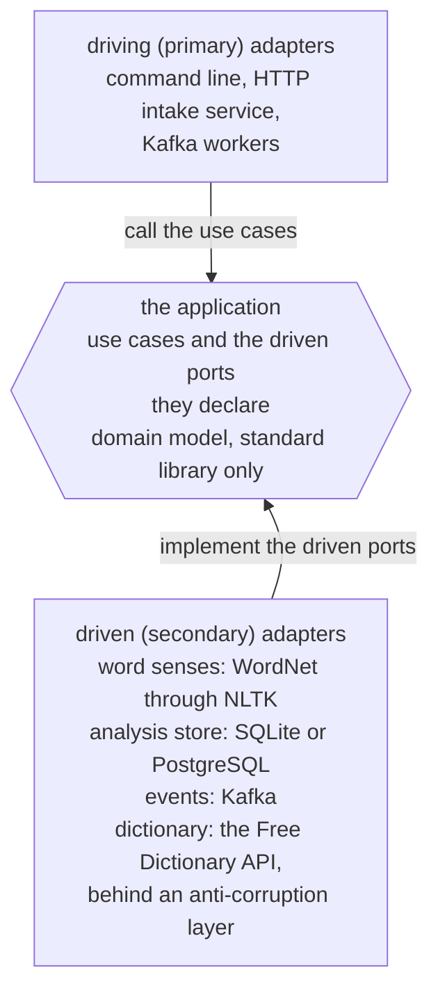

# Oleg Turzhanskii

I am a software engineer, Python by preference, who enjoys building systems
from their foundations: deciding on their structure, boundaries, and
components, and weighing the trade-offs those decisions bring.

I also have a longstanding fascination with natural languages, English above
all.

[Wordwinnow](https://github.com/wordbench/wordwinnow) is where the two meet: a command-line tool for learning
vocabulary from real English texts, which picks out the words worth a
learner's attention at the learner's own level.

[![Wordwinnow in a terminal, reading Sherlock Holmes's line "You see, but you
do not observe. The distinction is clear." for a learner at B1 and picking out
distinction and observe, each with its CEFR level, a meaning, related words,
and the sentence it came from][demo]][run]

[demo]: assets/wordwinnow.gif
[run]: https://github.com/wordbench/wordwinnow#running-it

## Languages

English has a special place for me: learning it is a lifelong journey rather
than a course to finish, because there is always more to learn.

The curiosity behind it has become a habit of attention: to precision and
nuance, to natural phrasing, and to which words go together and which merely
could.

People close to me sometimes call me a snob when it comes to English, and I
take it as a compliment; they have a word for the computing side too: nerd.

I have a soft spot for American English, but I want to feel at home wherever
English is spoken, because it is a world language rather than one country's.

My curiosity reaches other languages too, and I am learning Spanish.

Programming languages hold the same fascination for me, and Python is the one
I reach for first rather than the only one I work in, as my dotfiles show.

Wordwinnow comes from what that curiosity costs: stopping at every word worth
investigating takes some of the pleasure out of a series or an article, so it
does the looking-up before I read or watch.

It is also where the curiosity became practical natural language processing:
tagging and lemmatizing with NLTK, word senses from WordNet, and a model that
estimates a word's level where no published list gives one.

## Architecture

I enjoy deciding how much structure a system needs and how much of it to build
myself, so given the choice I start from a foundation that leaves those
decisions to me.

In Wordwinnow, Domain-Driven Design gives the problem its own vocabulary, kept
in a domain that needs nothing but the standard library, so its rules are
tested without a database, a broker, or a network.

Hexagonal Architecture keeps every technology at the edge, so the same use
cases run in one process or as services.

Every arrow is a dependency, and a test that scans every import fails if one
points the other way; it is shown to catch a deliberate violation.

Event-Driven Architecture appears at exactly one seam, where a request has to
be answered at once while the slow analysis happens elsewhere.

The lesson I take from Wordwinnow and from Wordbench, my later and separate
project on the same problem, is plain: the problem has to come first, and the
technology has to follow.

## How I work

I like to settle the problem and its boundaries before I choose anything that
will serve them, and then to choose deliberately: a tool earns its place by
answering a need I can name, and it stays replaceable.

That is how Wordwinnow is built, with the domain at the center and every
technology at the edge, and it is how my environment is built too: a
configurable editor with small tools composed around it, rather than one
integrated environment that decides my conventions for me.

My [dotfiles](https://github.com/olegturzhanskii/dotfiles) are that environment written down, with a setup that shows its
plan before acting, and a Neovim configuration that began as kickstart.nvim, a
starting point meant to be forked and edited, and has changed substantially
since.

One key shows what composing small tools means: `Ctrl-T` opens fzf in a tmux
popup, `fd` supplies the list, and `bat` draws the preview.

I work in small, inspectable steps, each checked before the next, and my
projects follow [engineering-conventions](https://github.com/olegturzhanskii/engineering-conventions), a versioned standard for Python
projects that ships with the tooling to check it, so a project names the
version it follows, carries the checks in its own gate, and lets a reviewer
tell a violation from a version gap.

One rule in it governs the checks themselves: every automated check must prove
it can fail, by catching a case it is known to catch, because a check that can
fail open is not a check.

Generative AI is part of that process: models contribute substantially to my
projects, in reasoning and in implementation alike, and each project's README
says which ones and how.

What stays mine is the direction and the requirements, the judgment of every
proposal against the evidence, and the responsibility for what is published.

Both projects belong to the [Wordbench organization](https://github.com/wordbench), with Wordwinnow public
and Wordbench not yet.
